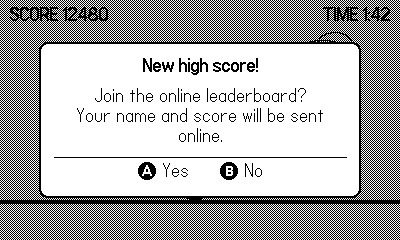
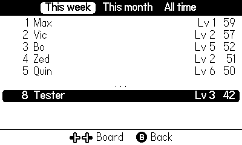
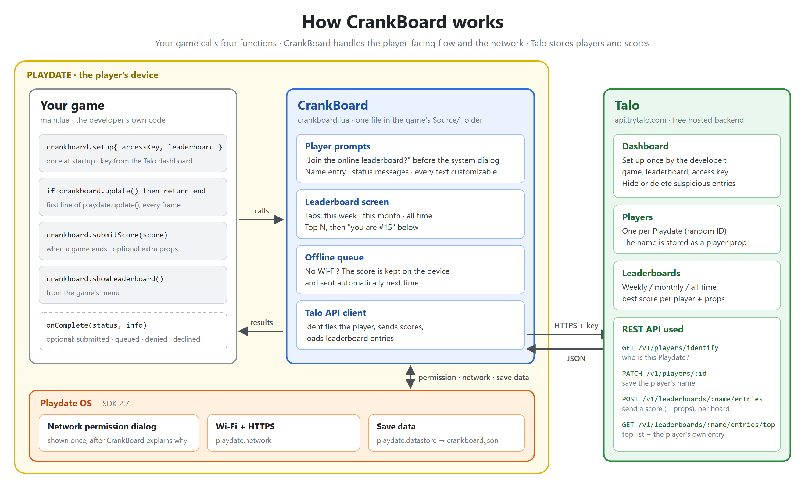
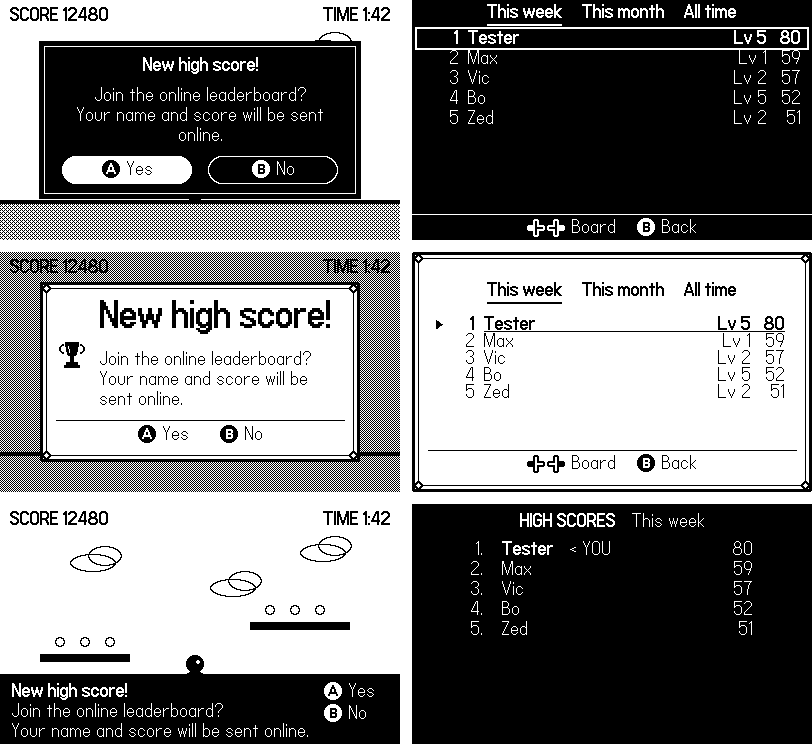

# CrankBoard

**Online high score tables for Playdate games**, for games you share yourself (itch.io, your own
site) rather than through Catalog. Free: the scores are stored by [Talo](https://trytalo.com), a free
online service.

You add one file to your game and a few lines of code. CrankBoard does the rest:

- asks the player **once** whether they want to join the online leaderboard;
- asks the Playdate for internet access, and explains why first;
- asks for a name the first time;
- sends the score, and if there's no Wi-Fi, keeps it and sends it later;
- shows a ready-made leaderboard screen, with the player's own place highlighted.

| The question after the first score | The leaderboard screen |
|---|---|
|  |  |

You need Playdate SDK **2.7 or newer**.

## How it works



Your game tells CrankBoard "here's a score" and "show the leaderboard". CrankBoard talks to the
player and to the Playdate, and sends the scores to Talo over the internet.

## Quick start

It takes about 15 minutes, most of it in Talo.

### 1. Set up Talo

Create a free account, a game, a leaderboard called `highscores` and an access key.
**Follow the step-by-step guide: [Setting up Talo](docs/talo-setup.md).** At the end you have an
access key (a long text) to paste into your game.

### 2. Add CrankBoard to your game

Download [`crankboard.lua`](crankboard.lua) and put it in your game's `Source` folder, next to
`main.lua`.

### 3. Connect it

At the top of `main.lua`:

```lua
import "crankboard"

crankboard.setup({
    accessKey = "PASTE_YOUR_TALO_ACCESS_KEY_HERE",
    leaderboard = "highscores",
})
```

Is your game's code on GitHub or in another git repository? Then put the key in a separate file
that stays out of git: see [Keep the access key out of git](#keep-the-access-key-out-of-git).

### 4. Give CrankBoard a turn every frame

Put these lines at the **very start** of your `playdate.update()`:

```lua
function playdate.update()
    if crankboard.update() then
        return
    end

    -- your game, as before
end
```

While CrankBoard shows a question or the leaderboard, `crankboard.update()` returns `true`, and the
`return` makes your game wait. It also returns `true` in the frame it closes: the button that
answered the question is still "just pressed" then, and your game shouldn't react to it too.
Without these lines nothing happens.

Your timers (`playdate.timer`) wait too, like the rest of your game. CrankBoard doesn't need them:
its name keyboard works without `playdate.timer.updateTimers()`.

### 5. Send the score when the game is over

When the player beats their own best score:

```lua
if crankboard.isNewBest(score) then
    crankboard.submitScore(score)
end
```

You don't need to save the best score yourself: CrankBoard remembers it on the Playdate, even for
players who don't play online. Show it with `crankboard.getBest()`, e.g. "Best: 120" on your menu.

Do it a moment after "Game over", when the player isn't pressing buttons: the first time, a
question appears, and you don't want it answered by accident.

### 6. Let players see the leaderboard

For example, from the Playdate menu (the ⊙ button):

```lua
playdate.getSystemMenu():addMenuItem("leaderboard", function()
    crankboard.showLeaderboard()
end)
```

### 7. Try it

Run your game in the Simulator and finish a game with a new best score. You should see "Join the
online leaderboard?". Answer Yes, allow internet access, type a name, and the score is online.

Something went wrong? Look at the Simulator's console: CrankBoard's messages start with
`[crankboard]` and say what to fix. See also [When something goes wrong](#when-something-goes-wrong).

## Examples

Four examples, from the simplest to a full game:

| Example | Shows |
|---|---|
| [`examples/basics`](examples/basics/Source/main.lua) | **Read this first.** No game: only the four calls and when to make them. Ⓐ pretends a game ended, Ⓑ opens the leaderboard. |
| [`examples/one-leaderboard`](examples/one-leaderboard/Source/main.lua) | The same calls in a small real game ("press Ⓐ as fast as you can"): one leaderboard for all time. |
| [`examples/three-leaderboards`](examples/three-leaderboards/Source/main.lua) | The same game with this week, this month and all time as tabs, extra data with each score, the result of sending, and a menu to change the name or turn online scores off. |
| [`examples/custom-screens`](examples/custom-screens/Source/main.lua) | Every screen CrankBoard draws in its own small file, looking exactly like the built-in ones. Copy the `screens` folder into your game and change the look of just the screen you want. |

To run one: paste your access key into its `main.lua`, copy `crankboard.lua` into its `Source` folder,
and build that folder like any Playdate game. Or build from this folder without copying:

```sh
pdc -I . examples/basics/Source Basics.pdx
```

Each example has a `pdxinfo` file like every Playdate game. The Playdate shows the game's name from
it when it asks for internet access, and keeps each game's settings and saved data apart by its
`bundleID`. For your own game, use your own `bundleID`.

## Recipes

### One leaderboard for all time

That's the [quick start](#quick-start) and [`examples/one-leaderboard`](examples/one-leaderboard/Source/main.lua).
Send the score when the player beats their own best (`crankboard.isNewBest(score)`).

### This week, this month and all time

In Talo, create three leaderboards: `weekly` (Refresh entries: Weekly), `monthly` (Monthly) and
`alltime` (Never). Then:

```lua
crankboard.setup({
    accessKey = "...",
    leaderboards = {
        { name = "weekly", title = "This week" },
        { name = "monthly", title = "This month" },
        { name = "alltime", title = "All time" },
    },
})

-- after EVERY game: the score goes to all three leaderboards
crankboard.submitScore(score)

-- three tabs; the top 10 and the player's own place below
crankboard.showLeaderboard({ limit = 10 })
```

Send **every** game, not only records: a new week starts empty, so a player whose best ever is 80
still needs their 60 from this week. Talo keeps only each player's best score per leaderboard, so
nothing piles up. Full example: [`examples/three-leaderboards`](examples/three-leaderboards/Source/main.lua).

After the first score, "Score submitted!" shows the place on each leaderboard, one line each. For a
small dialog, give the leaderboards short names for it and put the places on one line:

```lua
leaderboards = {
    { name = "weekly", title = "This week", shortTitle = "Week" },  -- "Week: #3"
    ...
},
messages = { rankSeparator = "   " },  -- "Week: #3   Month: #5   All: #12"
```

Players who answered No still have their games counted: CrankBoard keeps the best game of each day
on the Playdate, and sends them if the player joins later (for example with the "Online scores"
option below), each with the date it was played. With the optional
[Continuity requests](docs/talo-setup.md#4-create-an-access-key) permission on the key, Talo then
puts each one in the right week and month.

### Easy, Normal and Hard

One leaderboard per difficulty. In Talo, create `easy`, `normal` and `hard`, all with Refresh
entries: Never. Then:

```lua
crankboard.setup({
    accessKey = "...",
    leaderboards = {
        { name = "easy", title = "Easy" },
        { name = "normal", title = "Normal" },
        { name = "hard", title = "Hard" },
    },
})

-- after a game on Hard: send it if it beats the best score on Hard.
-- Without "leaderboard" the score would go to all three!
if crankboard.isNewBest(score, "hard") then
    crankboard.submitScore(score, { leaderboard = "hard" })
end

-- the best score on each difficulty, for your menu
print(crankboard.getBest("easy"), crankboard.getBest("normal"), crankboard.getBest("hard"))

-- open the leaderboard on the tab of the current difficulty (1 = Easy, 2 = Normal, 3 = Hard)
crankboard.showLeaderboard({ tab = 3 })
```

CrankBoard keeps a separate best score for each difficulty.

Why not one leaderboard with the difficulty as extra data? Talo would rank all difficulties
together, so a player's place would be wrong. Separate leaderboards give each difficulty its own
correct ranking.

### Times: lower is better

For a race or a puzzle timed in milliseconds, create the leaderboard with **Sort mode: Ascending**,
tell CrankBoard that lower is better, and show the time nicely:

```lua
crankboard.setup({
    accessKey = "...",
    leaderboard = "besttimes",
    ascending = true, -- a lower score is better, for isNewBest() and getBest()
    formatScore = function(ms)
        return string.format("%d:%05.2f", ms // 60000, (ms % 60000) / 1000)
    end,
})
```

With several leaderboards, set it on the ones that need it:
`{ name = "besttimes", title = "Fastest", ascending = true }`.

### Your game already has high scores

Keep your own high score code, it works together with CrankBoard. One thing to add: players who
played before the update already have a best score that isn't online yet. Send the better of the
two the first time:

```lua
-- savedBest is the best score your game saved before
local best = math.max(score, savedBest)
if crankboard.isNewBest(best) then
    crankboard.submitScore(best)
end
```

### Extra data with a score

Save anything with a score, like the level or the character, and show it as a column:

```lua
crankboard.submitScore(score, { props = { level = 7, character = "cat" } })

crankboard.setup({
    ...,
    detail = function(row) return row.props.level and ("Lv " .. row.props.level) or "" end,
})
```

Talo keeps the data of the player's best score.

### Your game already asks for a name

Use one name for your game and the online leaderboard. Turn off CrankBoard's own keyboard, and
hand it your name before every score:

```lua
crankboard.setup({
    ...,
    askName = false,
})

-- when a game ends
crankboard.setName(playerName)   -- the name from your own name screen
crankboard.submitScore(score)
```

If the player changes the name in your game, the new name goes online with the next score.
Set **Display name prop key** in Talo ([step 5](docs/talo-setup.md#5-recommended-use-the-players-current-name))
so the new name also shows on leaderboards where the player hasn't sent a score since.

### An "Online scores" option

```lua
playdate.getSystemMenu():addCheckmarkMenuItem("online", crankboard.isOptedIn(), function(on)
    crankboard.setOptedIn(on)
end)
```

When the player turns it on, CrankBoard sends the scores made while it was off (the best one of each
day, per leaderboard). You don't need to send them yourself.

### Keep the access key out of git

If your game's code is on GitHub, don't write the key in `main.lua`. Put it in a file next to
`main.lua`, `Source/crankboard_key.json`:

```json
{ "accessKey": "the key you copied from Talo" }
```

and tell CrankBoard to read it:

```lua
crankboard.setup({
    accessKeyFile = "crankboard_key.json",
    leaderboard = "highscores",
})
```

Add `Source/crankboard_key.json` to your `.gitignore`. To show others what goes in it, commit a copy
with a placeholder, e.g. `crankboard_key.example.json` with `{ "accessKey": "PASTE_YOUR_TALO_ACCESS_KEY_HERE" }`.

Without the file (a fresh checkout, a friend building your game) the game still builds and runs,
just without online leaderboards: CrankBoard says so in the console, never asks the player to join,
and keeps the best scores on the Playdate as usual. Hide your leaderboard menu item then:

```lua
if crankboard.isEnabled() then
    playdate.getSystemMenu():addMenuItem("leaderboard", function() crankboard.showLeaderboard() end)
end
```

The file can also point the game at the [test server](#can-i-try-it-without-a-talo-account):
`{ "accessKey": "anything", "host": "127.0.0.1", "port": 8787, "useSSL": false }`.

The key still ends up inside the built game (`.pdx`), as it always does: see
[Can players cheat?](#can-players-cheat).

### Your own leaderboard screen

`crankboard.getEntries()` loads the rows and `crankboard.getCachedEntries()` gives the ones saved the
last time, right away. Show the saved rows at once, then load fresh ones in the background:

```lua
local rows, saved = crankboard.getCachedEntries({ leaderboard = "alltime", limit = 10 })
-- draw rows (nil if it never loaded); saved.ago is e.g. "2 days ago"

crankboard.getEntries({ leaderboard = "alltime", limit = 10, onComplete = function(ok, fresh, info)
    if ok then rows = fresh end
    -- info.cached is true when there was no connection: these are the saved rows again
end })
```

## Make it look like your game

Change the colors and buttons with a few settings, add your own frame, icons and fonts, or draw
everything yourself. You can also change every text, for example to translate your game.



See [Customizing the look](docs/customizing.md) and [Texts](docs/api.md#texts). To redraw a screen
yourself, start from the ready-made screen files in [`examples/custom-screens`](examples/custom-screens/Source/main.lua).

## When something goes wrong

### Nothing happens when I call `crankboard.submitScore()`

`crankboard.update()` must be called at the start of `playdate.update()`, see
[step 4](#4-give-crankboard-a-turn-every-frame). CrankBoard warns about it in the console.

Also check that the access key is pasted in. While `accessKey` is still the placeholder, or the
`accessKeyFile` is missing, online leaderboards are off and the console says so.

### "Couldn't connect" or "The score could not be submitted"

Open the Simulator's console. CrankBoard's messages start with `[crankboard]` and say what's wrong:
a wrong access key, a missing permission on the key, or a leaderboard name that doesn't exist in Talo
(names are case-sensitive). For more detail, add `debug = true` to `crankboard.setup()`.

### I want to see the question again

Call `crankboard.resetPrompt()` once, or delete your game's data in the Simulator.

### Scores from the Simulator don't show up on my Playdate

That's on purpose. Scores from the Simulator are marked as test data ("dev data"), so your tests
never mix with real players' scores. The Simulator shows test data; a real Playdate and the Talo
dashboard don't (in the dashboard you can turn dev data on). To test with real data from the
Simulator, add `devBuild = false` to `crankboard.setup()`.

### There's no Wi-Fi

Scores are kept on the Playdate and sent automatically next time. The leaderboard screen shows the
scores it loaded the last time, with "No connection: scores from 2 days ago" under the tabs. If it
never loaded before, a "Couldn't connect" message appears instead.

### How do I test without a connection?

Point the game at a server that doesn't answer:

- `host = "10.255.255.1"`: the connection hangs until `connectTimeout` (10 seconds), so you see the
  "Sending score..." and "Loading..." screens;
- `host = "127.0.0.1", port = 8799, useSSL = false` (a port nothing listens on): it fails at once.

### A player changed their name, but a leaderboard shows the old one

Set **Display name prop key** to `name` in Talo, see
[step 5 of the Talo guide](docs/talo-setup.md#5-recommended-use-the-players-current-name). The player's
own row always shows their current name.

### The player didn't allow internet access

The Playdate remembers that answer. The player can change it in **Settings > Permissions**.
Meanwhile CrankBoard keeps their scores and sends them later.

### Can players cheat?

A determined player could send a fake score: the access key is inside your game. That's true for
every online leaderboard that has no server of its own. Give the key only the permissions from the
[Talo guide](docs/talo-setup.md#4-create-an-access-key), and remove cheats in the Talo dashboard.

### Can I try it without a Talo account?

Yes. [`tools/mock_talo.py`](tools/mock_talo.py) is a tiny test server that works like Talo on your
computer (it needs Python 3):

```sh
python tools/mock_talo.py --seed 30
```

`--seed 30` adds 30 fake players. For several leaderboards, name them:
`--leaderboard weekly --leaderboard monthly --leaderboard alltime`. Then point your game at it:

```lua
crankboard.setup({
    accessKey = "anything",
    leaderboard = "highscores",
    host = "127.0.0.1", port = 8787, useSSL = false,
})
```

Use `127.0.0.1`, not `localhost`.

## Reference

Every function and setting: [CrankBoard reference](docs/api.md).

## License and credits

CrankBoard is made by [BitCaliberGames](https://bitcalibergames.itch.io/) and released under the
[MIT License](LICENSE): you can use it in free and paid games, change it and share it. Keep the
`LICENSE` file with the code.

If CrankBoard helped you, a line in your game's credits is very welcome, for example:
"Online leaderboards: CrankBoard by BitCaliberGames". It's not required, just appreciated.

CrankBoard is an independent project, not affiliated with or endorsed by Panic Inc. (Playdate) or
Talo.
