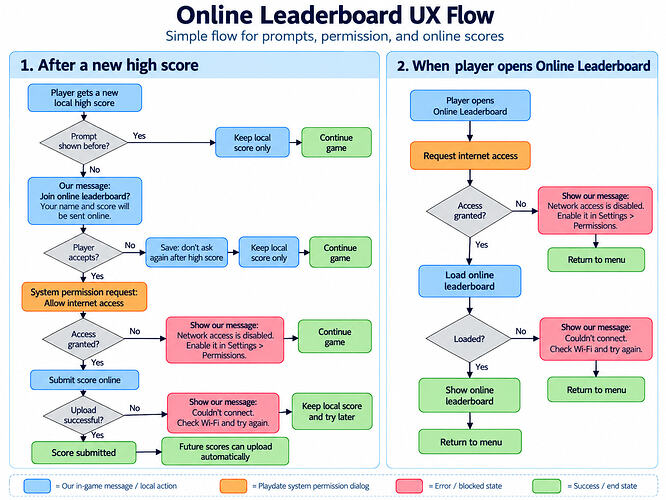

# CrankBoard reference

Everything CrankBoard can do. To get started, read the [README](../README.md) first.

- [crankboard.setup](#crankboardsetupoptions)
- [crankboard.update](#crankboardupdate)
- [crankboard.submitScore](#crankboardsubmitscorescore-options)
- [crankboard.showLeaderboard](#crankboardshowleaderboardoptions)
- [crankboard.getBest](#crankboardgetbestleaderboard) and [isNewBest](#crankboardisnewbestscore-leaderboard)
- [crankboard.getEntries](#crankboardgetentriesoptions) and [getCachedEntries](#crankboardgetcachedentriesoptions)
- [Other functions](#other-functions)
- [Texts](#texts)
- [How it works](#how-it-works)

## crankboard.setup(options)

Call it once, when your game starts.

```lua
crankboard.setup({
    accessKey = "your Talo access key",
    leaderboard = "highscores",
})
```

| Option | Default | What it is |
|---|---|---|
| `accessKey` | | Your Talo access key ([how to get it](talo-setup.md#4-create-an-access-key)). This or `accessKeyFile` is required. |
| `accessKeyFile` | | A JSON file in your `Source` folder with the key, so it stays out of git: `{ "accessKey": "..." }`. It may also set `host`, `port`, `useSSL` and `basePath`. See [Keep the access key out of git](../README.md#keep-the-access-key-out-of-git). |
| `leaderboard` | | The internal name of your leaderboard in Talo. |
| `leaderboards` | | Several leaderboards, instead of `leaderboard`: `{ "weekly", "alltime" }`, or with tab titles: `{ { name = "weekly", title = "This week", shortTitle = "Week" }, ... }`. `title` is for the tabs, `shortTitle` for the places in "Score submitted!" (default: `title`). |
| `messages` | | Your own texts, e.g. a translation. See [Texts](#texts). |
| `formatScore` | whole number | `function(score) return "..." end`: how scores are shown, e.g. as a time. |
| `ascending` | `false` | `true` if a lower score is better (times), for `isNewBest` and `getBest`. A leaderboard in `leaderboards` can have its own: `{ name = "times", ascending = true }`. |
| `detail` | | `function(row) return "..." end`: an extra column on the leaderboard, e.g. from `row.props`. |
| `style` | | The look. See [Customizing the look](customizing.md). |
| `draw` | | Your own drawing functions. See [Customizing the look](customizing.md#level-3-your-own-drawing). |
| `sounds` | keyboard sounds | Your own sounds, or `false` for none. See [Sounds](customizing.md#sounds). |
| `askName` | `true` | Ask for a name the first time a score is sent. If `false`, the name is "Player XXXX" unless you call `setName`. |
| `maxNameLength` | `16` | The longest name a player can type. |
| `topLimit` | `50` | How many of the best scores the leaderboard screen shows (at most 200). |
| `devBuild` | `true` in the Simulator | Marks scores as test data ("dev data") in Talo. See the [README FAQ](../README.md#scores-from-the-simulator-dont-show-up-on-my-playdate). |
| `debug` | `false` | Print every request in the console, to see what's going on. |
| `timeout` | `20` | Seconds to wait for Talo before giving up. |
| `connectTimeout` | `10` | Seconds to wait for the connection. |
| `maxPending` | `60` | How many unsent scores to keep on the Playdate (one per leaderboard). |
| `namePropKey` | `"name"` | The Talo property that stores the player's name. |
| `saveFile` | `"crankboard"` | The file CrankBoard saves its data to (`crankboard.json` in your game's data). |
| `host`, `port`, `useSSL`, `basePath` | Talo | For a self-hosted Talo or the test server. |
| `service` | `"playdate"` | How Talo labels players created by CrankBoard. |
| `font`, `boldFont` | system fonts | Short for `style.font` and `style.titleFont`. |

## crankboard.update()

Call it at the very start of `playdate.update()`, every frame:

```lua
function playdate.update()
    if crankboard.update() then
        return
    end
    -- your game
end
```

It returns `true` while CrankBoard shows something (a question, a message, the leaderboard), and in
the frame it closes. Then your game should skip that frame: don't move, don't draw. In the closing
frame the button that closed CrankBoard still reads as just pressed, so skipping it keeps your game
from reacting to that button too. CrankBoard also blocks your button callbacks while it's shown, and
when it's done, it puts your game's last frame back on the screen.

Your `playdate.timer` timers wait while you skip `playdate.timer.updateTimers()`, which is usually
what you want. CrankBoard's name keyboard doesn't need them.

Without this call, nothing happens: no questions, no sending, no leaderboard.

## crankboard.submitScore(score, options)

Sends a score. All options are optional.

```lua
crankboard.submitScore(score)

crankboard.submitScore(score, {
    leaderboard = "hard",               -- send to this leaderboard only
    leaderboards = { "weekly", "alltime" }, -- or to these
    props = { level = 7, character = "cat" }, -- extra data saved with the score
    onComplete = function(result, info)
        -- see the table below
    end,
})
```

Without `leaderboard` or `leaderboards`, the score goes to **every** leaderboard from `setup`.

It also keeps the player's best score on this Playdate (see [getBest](#crankboardgetbestleaderboard)),
even for players who don't play online, and **returns `true` right away if the score is a new best**:

```lua
local newBest = crankboard.submitScore(score)
if newBest then
    -- show "New best score!"
end
```

**When to call it:**

- one all-time leaderboard: when the player beats their own best score;
- weekly or monthly leaderboards: after every game. A new week starts empty, so a player whose best
  ever is 80 still needs their 60 from this week. Talo keeps only each player's best score per
  leaderboard, so sending every game is fine.

Call it when the player isn't pressing buttons, for example a second after "Game over": the first
time, a question appears and you don't want it answered by accident.

**What happens:**



| Situation | What the player sees | `result` |
|---|---|---|
| First score ever | "Join the online leaderboard?" | |
| The player answers No | Nothing more. The question isn't asked again. | `crankboard.DECLINED` |
| The player answers Yes | The Playdate asks to allow internet access. | |
| The player doesn't allow it | "Network access is disabled. Enable it in Settings > Permissions." | `crankboard.DENIED` |
| The player allows it | First time: the name keyboard. Then "Score submitted! You are #12". | `crankboard.SUBMITTED` |
| No connection | "Couldn't connect. Your score is saved and will be sent next time." | `crankboard.QUEUED` |
| The player joined earlier | Nothing: the score is sent in the background. | `SUBMITTED`, `QUEUED` or `DENIED` |
| The player said No earlier | Nothing: the score stays on the Playdate. | `crankboard.LOCAL` |
| Online is off (no access key, see [isEnabled](#other-functions)) | Nothing: the score stays on the Playdate. | `crankboard.LOCAL` |
| Talo refused the score (e.g. a wrong leaderboard name) | "The score could not be submitted." | `crankboard.FAILED` |

`info` (when sent): `info.rank` is the place on the first leaderboard (1 = best), and
`info.ranks.weekly`, `info.ranks.alltime`, ... the place on each one. On `FAILED`, `info.error`
says why. `info.newBest` is `true` if the score was a new best on this Playdate. `info.joined` is
`true` if the player answered Yes to the question in this call (whatever happened next).

**Players who said No.** Their scores aren't lost: CrankBoard keeps the best score of each day, per
leaderboard, on the Playdate (and the best ever). If the player joins later, with
[setOptedIn](#other-functions) or when the question is asked again, they are sent with the date they
were played, so weekly and monthly leaderboards get them too (with the optional
[Continuity requests](talo-setup.md#4-create-an-access-key) permission on the key).

Scores that couldn't be sent are kept and sent automatically next time (or call
`crankboard.flush()`). Several `submitScore()` calls in a row are fine: the question is asked once.

## crankboard.showLeaderboard(options)

Opens the leaderboard screen. The player switches tabs with ⬅️ ➡️, scrolls with ⬆️ ⬇️ or the crank,
and closes it with Ⓐ or Ⓑ. All options are optional.

```lua
crankboard.showLeaderboard()

crankboard.showLeaderboard({
    leaderboards = { "easy", "normal", "hard" }, -- tabs (default: every leaderboard from setup)
    leaderboard = "hard",               -- or just this one, without tabs
    title = "Hall of Fame",             -- the title when there's one leaderboard
    tab = 3,                            -- open on the third tab
    limit = 10,                         -- show the top 10; the player's own place is added below
    formatScore = function(score) return score .. " pts" end,
    detail = function(row) return row.props.level end,
    onClose = function(shown) end,      -- shown is false if it couldn't be loaded
})
```

With `limit = 10`, a player in 15th place sees the top 10, then ". . .", then their own row with
"15". Their own row is always highlighted.

If the internet is off or Talo can't be reached, the screen shows the scores it loaded the last time,
with "No connection: scores from 2 days ago" under the tabs. If it never loaded before, a message
appears and the screen closes.

## crankboard.getBest(leaderboard)

The player's best score on this Playdate, or `nil` if there isn't one yet. Without a name, the first
leaderboard from `setup`. Every `submitScore` keeps it up to date, also for players who said No to
online scores, so your game doesn't need to save it.

```lua
gfx.drawText("Best: " .. (crankboard.getBest() or 0), 10, 10)
```

There is one best score per leaderboard (`crankboard.getBest("hard")`), and it's the best ever: it
doesn't start over with weekly or monthly leaderboards.

## crankboard.isNewBest(score, leaderboard)

`true` if the score would beat the player's best (and for the very first score). It doesn't change
anything; `submitScore` saves the new best.

```lua
if crankboard.isNewBest(score) then
    crankboard.submitScore(score)
end
```

## crankboard.getEntries(options)

Loads a leaderboard without showing anything, for when you draw your own leaderboard screen.

```lua
crankboard.getEntries({
    leaderboard = "weekly",   -- default: the first leaderboard from setup
    limit = 10,
    onComplete = function(ok, rows, info)
        if not ok then return end      -- info is the error text
        if info.cached then
            -- no connection: these are the rows saved the last time, info.ago is e.g. "2 days ago"
        end
        for _, row in ipairs(rows) do
            -- row.rank (1 = best), row.name, row.score (as text), row.props, row.own (true for the player)
            -- a row with row.gap = true separates the top list from the player's own row
        end
    end,
})
```

Like the leaderboard screen, it saves the rows it loads. When there is no connection it gives the
saved rows instead: `ok` is `true`, and `info` is `{ cached = true, savedAt, ago, error }` (`savedAt`
in Unix seconds). Saved rows have no `row.entry`. Pass `cache = false` to get `ok = false` instead.
When the rows are fresh, `info` is Talo's own answer. `ok` is `false` (and `info` the error) only when
there's nothing to show, or Talo refused (e.g. a wrong leaderboard name).

## crankboard.getCachedEntries(options)

The rows saved the last time a leaderboard loaded, right away, without the internet. Handy to show
something at once and then call `getEntries` for fresh rows.

```lua
local rows, info = crankboard.getCachedEntries({ leaderboard = "weekly", limit = 10 })
if rows then
    -- the same rows as getEntries; info.ago is e.g. "2 days ago"
end
```

`nil` if that leaderboard never loaded on this Playdate. Options: `leaderboard`, `limit`, `formatScore`.

## Other functions

| Function | What it does |
|---|---|
| `crankboard.flush(onDone)` | Sends scores that couldn't be sent earlier. Safe to call at startup. `onDone(ok, sent)`: `ok` is `false` if some are still waiting, `sent` is how many went online (`0` when there was nothing to send). |
| `crankboard.editName(onDone)` | Shows the keyboard so the player can change their name. |
| `crankboard.getName()` | The player's name, or `nil`. |
| `crankboard.setName(name)` | Sets the name yourself, e.g. if your game already asks for one. Then no keyboard is shown. |
| `crankboard.isOptedIn()` | `true` if the player agreed to send scores online. |
| `crankboard.setOptedIn(on)` | For an "Online scores: on/off" option. Turning it on skips the question and sends the scores made while it was off. |
| `crankboard.isEnabled()` | `false` when there is no access key (the placeholder, or a missing `accessKeyFile`). Then nothing goes online and the question never appears; hide your leaderboard menu item. |
| `crankboard.wasPrompted()` | `true` if the question was already asked. |
| `crankboard.resetPrompt()` | Asks the question again next time (handy while testing). |
| `crankboard.pendingCount()` | How many scores are waiting to be sent. |
| `crankboard.isActive()` | `true` while CrankBoard shows something. |
| `crankboard.isBusy()` | `true` while anything is going on, even in the background. |
| `crankboard.reset()` | Forgets everything, even the player's identity. For testing only. |

## Texts

Change any text with `messages`, for example to translate your game:

```lua
crankboard.setup({
    accessKey = "...",
    leaderboard = "highscores",
    messages = {
        joinTitle = "Nouveau record !",
        joinText = "Rejoindre le classement en ligne ?\nTon nom et ton score seront envoyés.",
        yes = "Ⓐ Oui",
        no = "Ⓑ Non",
    },
})
```

| Key | Default |
|---|---|
| `joinTitle` | New high score! |
| `joinText` | Join the online leaderboard? Your name and score will be sent online. |
| `yes`, `no`, `ok` | Ⓐ Yes, Ⓑ No, Ⓐ OK |
| `accessReason` | Sends your high scores to the online leaderboard and shows the best players. (Shown by the Playdate in its own "Allow Internet Access?" dialog.) |
| `accessDenied` | Network access is disabled. Enable it in Settings > Permissions. |
| `connectFailed` | Couldn't connect. Check Wi-Fi and try again. |
| `uploadFailed` | Couldn't connect. Your score is saved and will be sent next time. |
| `rejected` | The score could not be submitted. |
| `sending` | Sending score |
| `submitted` | Score submitted! |
| `submittedRank` | Score submitted! You are #%d (`%d` becomes the place) |
| `rankLine` | %s: #%d (one per leaderboard, e.g. "This week: #3"; `%s` is the `shortTitle`, or the `title`) |
| `rankSeparator` | a new line (between the `rankLine`s; e.g. `"   "` puts them on one line) |
| `loading` | Loading |
| `wait` | Please wait |
| `enterName` | Enter your name for the online leaderboard |
| `leaderboardTitle` | Online Leaderboard |
| `empty` | No scores yet. Be the first! |
| `offlineNote` | No connection: scores from %s (`%s` becomes e.g. "2 days ago") |
| `justNow`, `minutesAgo`, `hoursAgo`, `yesterday`, `daysAgo` | a moment ago, %d min ago, %d h ago, yesterday, %d days ago |
| `retry` | Ⓐ Retry |
| `tabHint`, `scrollHint`, `backHint` | ⬅️➡️ Board, ⬆️⬇️ Scroll, Ⓑ Back |
| `defaultName` | Player |

`\n` starts a new line.

## How it works

- **Who is who.** The first time a score is sent, CrankBoard creates a random ID for this Playdate
  (like `pd-3fa2c81b5e9d0a47`) and saves it in your game's data. Talo tells players apart by this ID,
  not by name, so two players can both be called "Bob". If the player deletes your game's data, they
  get a new ID.
- **What is sent:** the random ID, the name the player typed, the score, your `props`, and for scores
  sent later the time of the game. Nothing else: no serial number, no account.
- **Where it's saved:** CrankBoard keeps its data (did the player agree, the name, the best scores,
  unsent scores, the scores kept while the player wasn't online, the last loaded leaderboards) in `crankboard.json` in your game's data folder, apart
  from your own save data.
- **Talo requests:** `GET /v1/players/identify` (who is this Playdate), `PATCH /v1/players/:id` (save
  the name), `POST /v1/leaderboards/:name/entries` (send a score, once per leaderboard) and
  `GET /v1/leaderboards/:name/entries/top` (the top list plus the player's own entry with its place).
- **Why `update()`:** the Playdate can only show its "Allow Internet Access?" dialog from inside
  `playdate.update()`, so CrankBoard does all its network work there.
