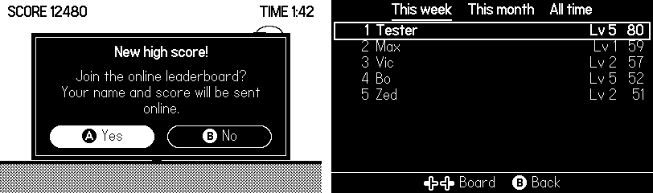
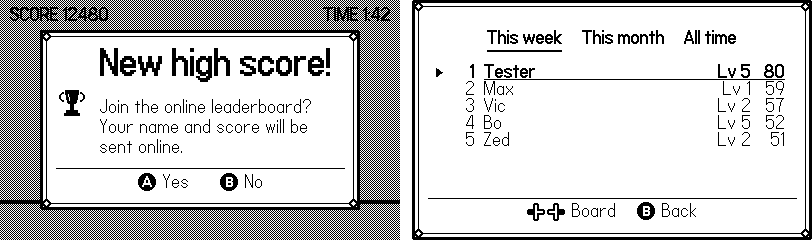
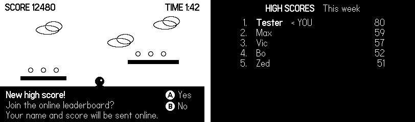

# Customizing the look

CrankBoard looks fine out of the box. If you want it to match your game, there are three levels.
Pick the first one that does what you need:

| Level | You... | Good for |
|---|---|---|
| 1. Style settings | change a few settings | white on black, square corners, different buttons |
| 2. Frame, icons, fonts | add a few images and fonts | making the dialogs look like they belong to your game |
| 3. Your own drawing | write the drawing code | a completely different look |

In every level CrankBoard still does the work: the questions, the buttons, sending the scores.

## Level 1: style settings

```lua
crankboard.setup({
    accessKey = "...",
    leaderboard = "highscores",
    style = {
        inverted = true,          -- white on black
        cornerRadius = 0,         -- square corners
        doubleBorder = true,      -- a thin second line inside the border
        dim = false,              -- don't darken the game behind the dialogs
        buttons = "pills",        -- rounded buttons; or "text": "Ⓐ Yes   Ⓑ No" under a line
        tabs = "underline",       -- the current tab is underlined; or "bar"
        ownRow = "outline",       -- the player's own row has a frame; or "fill", "arrow"
    },
})
```



All style settings:

| Setting | Default | What it does |
|---|---|---|
| `inverted` | `false` | White on black instead of black on white. |
| `dim` | `0.5` | How much to darken the game behind dialogs, from `0` to `1`, or `false`. |
| `dialogWidth` | `320` | Dialog width in pixels. |
| `padding` | `14` | Space inside the dialog. |
| `cornerRadius` | `8` | Rounded corners; `0` for square ones. |
| `borderWidth` | `2` | Border thickness; `0` for no border. |
| `doubleBorder` | `false` | A thin second line inside the border. |
| `buttons` | `"text"` | `"text"`: "Ⓐ Yes   Ⓑ No" under a line. `"pills"`: rounded buttons. |
| `tabs` | `"bar"` | `"bar"`: tabs in a dark bar. `"underline"`: the current tab is underlined. |
| `ownRow` | `"fill"` | The player's own row: `"fill"`, `"outline"` or `"arrow"`. |
| `rowHeight` | `20` | Height of a leaderboard row. |
| `headerHeight` | `26` | Height of the tab bar. |
| `visibleRows` | automatic | Rows per page on the leaderboard. |
| `frame` | none | A 9-slice frame image for the dialogs (level 2). |
| `boardFrame` | none | A 9-slice frame around the whole leaderboard screen (level 2). |
| `frameInset` | corner size | Space between a frame and the text. |
| `icons` | none | `{ join = ..., submitted = ..., error = ... }`: images shown left of the dialog text. |
| `font` | system font | Text and leaderboard rows. A path like `"fonts/MyFont"` or a font object. |
| `titleFont` | system bold | Titles and tabs. |
| `ownFont` | `titleFont` | The player's own row. |
| `buttonFont` | system font | Button hints (Ⓐ, Ⓑ, ⬆️). Must contain these symbols. |
| `titleScale` | `1` | `2` draws titles twice as big, nice for small pixel fonts. |
| `textMode` | `"fill"` | `"fill"` recolors text to black or white. `"copy"` draws fonts as they are. |

## Level 2: your frame, icons and fonts

Draw a small frame image, for example 48×48 pixels. CrankBoard cuts it into 9 parts (the corners are
a third of the image each) and stretches the middle parts, so the same image works for any size.

```lua
style = {
    frame = "images/frame",           -- dialogs
    boardFrame = "images/frame",      -- around the whole leaderboard screen
    icons = { join = "images/trophy", submitted = "images/star", error = "images/cloud" },
    font = "fonts/MyFont",            -- text and rows
    titleFont = "fonts/MyFont-Bold",  -- titles and tabs
    titleScale = 2,                   -- titles twice as big
    ownRow = "arrow",
}
```

Paths are relative to your `Source` folder, without the file extension, like everywhere in the
Playdate SDK.



Two things to know about fonts:

- The button hints (Ⓐ, Ⓑ, ⬆️) always use `buttonFont`, the system font by default. Most fonts,
  even the system *bold* font, don't have these symbols.
- Some pixel fonts draw white letters with a black outline (many arcade fonts do). With the default
  `textMode = "fill"` the outline is recolored too and the letters turn into blobs; set
  `textMode = "copy"` for such fonts.

## Level 3: your own drawing

**The easiest way to start:** [`examples/custom-screens`](../examples/custom-screens/Source/main.lua)
has every screen in its own small file, drawn exactly like the built-in ones:

| File | Screen |
|---|---|
| [`screens/dialog.lua`](../examples/custom-screens/Source/screens/dialog.lua) | "Join the online leaderboard?", "Score submitted!", errors |
| [`screens/busy.lua`](../examples/custom-screens/Source/screens/busy.lua) | "Sending score...", "Loading..." |
| [`screens/keyboard.lua`](../examples/custom-screens/Source/screens/keyboard.lua) | the panel next to the name keyboard |
| [`screens/leaderboard.lua`](../examples/custom-screens/Source/screens/leaderboard.lua) | the leaderboard screen |

Copy the `screens` folder into your game's `Source` folder, then:

```lua
import "screens/dialog"
import "screens/leaderboard"   -- import only the screens you want to change

crankboard.setup({
    accessKey = "...",
    leaderboard = "highscores",
    draw = CrankBoardScreens,
})
```

Each file explains at the top what it gets and has the easy things to change (sizes, fonts) right
below. Screens you don't import keep the built-in look.

**Or write your own from scratch.** Give CrankBoard functions that draw a screen. It calls them every
frame and tells them what to show.
Anything you leave out keeps the built-in look. If one of your functions has an error, CrankBoard
prints a warning and draws the built-in look instead, so the game never gets stuck.

```lua
local gfx = playdate.graphics

crankboard.setup({
    accessKey = "...",
    leaderboard = "highscores",
    style = { dim = false },
    draw = {
        dialog = function(d, ctx)
            -- d.kind: "join", "submitted", "accessDenied", "connectFailed", "uploadFailed", "rejected"
            -- d.title, d.text, d.icon, d.buttons = { { button = "a", label = "Ⓐ Yes" }, ... }
            -- d.age: milliseconds since the dialog opened, for animations
            local y = 170 + math.max(0, 70 - d.age // 3) -- slides in from the bottom
            gfx.setColor(gfx.kColorBlack)
            gfx.fillRect(0, y, ctx.width, 70)
            gfx.setImageDrawMode(gfx.kDrawModeFillWhite)
            gfx.drawText("*" .. (d.title or "") .. "*", 12, y + 8)
            gfx.drawTextInRect(d.text, 12, y + 28, 300, 40, nil, "...")
            for i, b in ipairs(d.buttons) do gfx.drawText(b.label, 324, y + 8 + (i - 1) * 22) end
            gfx.setImageDrawMode(gfx.kDrawModeCopy)
        end,

        board = function(view, ctx)
            -- view.tabs, view.index, view.tab = { title, rows, scroll, loading, error, note }
            -- rows: { rank, name, score, props, own } or { gap = true }; view.visibleRows
            if not view.tab.rows then return ctx.drawDefault() end -- still loading, or an error
            gfx.clear(gfx.kColorBlack)
            gfx.setImageDrawMode(gfx.kDrawModeFillWhite)
            gfx.drawTextAligned("*HIGH SCORES*   " .. view.tab.title, 200, 8, kTextAlignment.center)
            local first = view.tab.scroll or 0
            for i = 1, view.visibleRows do
                local row = view.tab.rows[first + i]
                if not row then break end
                local y = 36 + (i - 1) * 20
                if row.gap then
                    gfx.drawTextAligned(". . .", 200, y, kTextAlignment.center)
                else
                    gfx.drawTextAligned(row.rank .. ".", 70, y, kTextAlignment.right)
                    gfx.drawText(row.own and ("*" .. row.name .. "*   < YOU") or row.name, 90, y)
                    gfx.drawTextAligned(row.score, 340, y, kTextAlignment.right)
                end
            end
            gfx.setImageDrawMode(gfx.kDrawModeCopy)
        end,
    },
})
```



What your functions get:

| Function | Draws | Gets |
|---|---|---|
| `dialog(d, ctx)` | questions and messages | `d.kind`, `d.title`, `d.text`, `d.icon`, `d.buttons`, `d.age`; for `"submitted"` also `d.ranks` |
| `busy(m, ctx)` | "Sending score..." and "Loading..." | `m.kind` (`"sending"`, `"loading"`, `"wait"`), `m.text`, `m.age` |
| `keyboard(k, ctx)` | the panel next to the name keyboard | `k.prompt`, `k.text`, `k.left` (where the keyboard starts) |
| `board(view, ctx)` | the leaderboard screen | `view.tabs`, `view.index`, `view.tab`, `view.visibleRows`, `view.hints`, `view.texts` (loading, empty, retry) |

`d.ranks` lists the player's place on each leaderboard the score went to, in order:
`{ { leaderboard = "weekly", title = "Week", rank = 3 }, ... }` (`title` is the leaderboard's
`shortTitle`, or its `title`). Use it to lay the places out your own way, for example in one line,
instead of `d.text`, which has one line per leaderboard.

`ctx` helps you draw:

- `ctx.width`, `ctx.height`: the screen size;
- `ctx.drawDefault()`: draws the built-in look for this screen (handy for "loading" and errors);
- `ctx.drawBackdrop(amount)`: draws your game's last frame, darkened by `amount` (0 to 1);
- `ctx.dots`: an animated "..." for busy texts;
- `ctx.style`: the current style settings.

For dialogs and busy screens your game's last frame is already drawn behind, darkened as set by
`style.dim`. The buttons work the same as always: CrankBoard reads Ⓐ, Ⓑ, the d-pad and the crank.

## Sounds

CrankBoard plays the Playdate keyboard's own sounds: when the player presses Ⓐ or Ⓑ, switches tabs
or scrolls, and when an error or "Score submitted!" appears. You can replace any of them or turn
them off:

```lua
crankboard.setup({
    ...,
    sounds = {
        confirm = "sounds/coin",   -- a sound file in your Source folder (without extension)
        success = mySamplePlayer,  -- or a playdate.sound.sampleplayer
        move = false,              -- no sound when switching tabs and scrolling
    },
})

crankboard.setup({ ..., sounds = false })   -- no sounds at all
```

| Sound | When |
|---|---|
| `confirm` | Ⓐ in a dialog |
| `cancel` | Ⓑ in a dialog, or closing the leaderboard |
| `move` | switching tabs, scrolling |
| `error` | an error message appears |
| `success` | "Score submitted!" appears |

A sound can also be a function; CrankBoard calls it with the sound's name.
